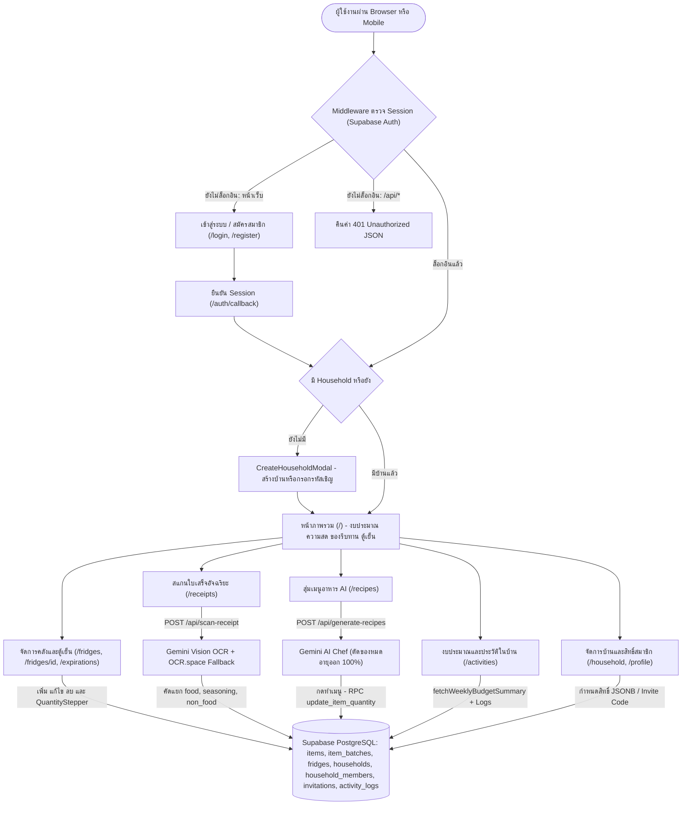
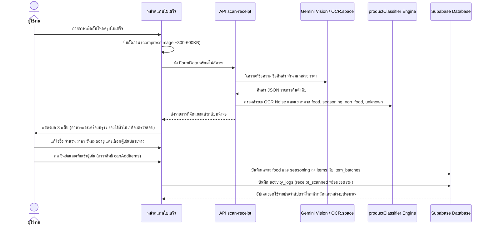
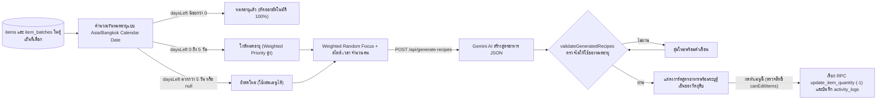

# CheckTuYen (Smart Fridge) — System Workflow & Prompt Guide

เอกสารสรุปขั้นตอนการทำงานทั้งหมดของระบบ **CheckTuYen (Smart Fridge)** อ้างอิงจากโครงสร้างโค้ดจริงในโปรเจกต์ พร้อม **Prompt สำหรับนำไปสร้างรูป Workflow Infographic**

---

## 1. ผังการทำงานภาพรวมของระบบ (Overall System Workflow)



---

## 2. เวิร์กโฟลระบบสแกนใบเสร็จและคำนวณงบ (Smart Receipt OCR & Budget Flow)



---

## 3. เวิร์กโฟลสุ่มเมนู AI และวันหมดอายุ (AI Recipe & Expiry Flow)



---

## 4. ระบบบทบาทและสิทธิ์สมาชิก (Household Role & Permissions)

| บทบาท | ดูรายการ | เพิ่มวัตถุดิบ / สแกนบิล | แก้ไข / ตัดสต็อก | ลบรายการ | จัดการสมาชิก & สิทธิ์ |
| :--- | :---: | :---: | :---: | :---: | :---: |
| **เจ้าของบ้าน (Owner)** | ได้ | ได้ | ได้ | ได้ | ได้ |
| **ผู้ดูแลบ้าน (Admin)** | ได้ | ได้ | ได้ | ได้ | ไม่ได้ |
| **สมาชิกทั่วไป (Member)** | ได้ (ค่าเริ่มต้น) | ตามที่ Owner กำหนด | ตามที่ Owner กำหนด | ตามที่ Owner กำหนด | ไม่ได้ |

---

## 5. Prompt สำหรับนำไปสร้างรูป Workflow (Image Generation Prompts)

สามารถคัดลอก Prompt ด้านล่างไปวางในเครื่องมือสร้างรูป AI (เช่น **Gemini / ChatGPT Image / Midjourney / Canva / Excalidraw AI**) เพื่อสร้างภาพ Workflow ได้เลยครับ

### ตัวเลือกที่ 1: Prompt ภาษาอังกฤษ (แนะนำ — ตัวอักษรและ Layout คมชัดที่สุด)

```text
Create a clean, modern flat-vector UI/UX system workflow infographic diagram for a Smart Fridge web application named "CheckTuYen".
Color palette: Warm Cream background (#FAF9F6), crisp pure White cards (#FFFFFF) with soft borders (#EAE6DF), Charcoal dark text (#252525), and Warm Orange primary accents (#EA580C and #F97316).
Layout style: Horizontal and vertical connected workflow cards with clean curved arrows, rounded pill badges, and minimal flat icons, 16:9 presentation format.

Include 5 clearly connected workflow stages:
1. "User & Household Auth": Login/Register icon connected to "Household Sharing & Member Permissions" (Owner, Admin, Member roles with household code #TY-CODE).
2. "Multi-Fridge Inventory": Refrigerator cards showing Emoji food items, quantity stepper (- / +), and 3 freshness status badges (Urgent Red, Expiring Amber, Fresh Green).
3. "Smart Receipt Scanner": Camera/Receipt upload -> Image Compression -> "Gemini Vision AI OCR" -> Auto-Filter Junk & Separate Food vs Non-Food -> Save to Fridge & Weekly Budget.
4. "AI Recipe Generator": Filter out expired food (100% safety block) -> Prioritize expiring items -> "Gemini AI Chef" generates recipes -> One-click "Cook & Auto-Deduct Stock".
5. "Weekly Budget & Activity Logs": Orange circular progress donut showing weekly budget spent/remaining + household timeline log synced with Supabase Database at the bottom layer.

Style: Professional SaaS product architecture infographic, minimalist warm Scandinavian aesthetic, high readability, clean typography, subtle drop shadows, no clutter, no distorted text.
```

### ตัวเลือกที่ 2: Prompt ภาษาไทย (สำหรับ Gemini / GPT Image ที่รองรับข้อความภาษาไทย)

```text
สร้างภาพ Infographic แผนผังขั้นตอนการทำงานของระบบเว็บแอปพลิเคชัน "CheckTuYen (เช็คตู้เย็นอัจฉริยะ)" ในสไตล์ Modern Minimal Flat Vector UI สะอาดตา อ่านง่าย เป็นระเบียบ ระดับงานนำเสนอโปรเจกต์
โทนสีหลัก: พื้นหลังสีครีมอุ่น (#FAF9F6), การ์ดสีขาวขอบโค้งมน (#FFFFFF), ตัวอักษรสีเทาเข้ม (#252525) และใช้สีส้มอุ่น (#EA580C / #F97316) เป็นสีหลักของระบบ พร้อมสีแดง/เหลือง/เขียวอ่อนเฉพาะป้ายสถานะวันหมดอายุ
ขนาดภาพ 16:9 แนวนอน มีเส้นลูกศรเชื่อมขั้นตอนอย่างเป็นระบบ แบ่งเป็น 5 ส่วนหลักดังนี้:

1. ระบบสมาชิกและครัวเรือน: เข้าสู่ระบบ -> สร้างหรือเข้าร่วมบ้านด้วยรหัสเชิญ -> กำหนดสิทธิ์สมาชิก (เจ้าของ / ผู้ดูแล / สมาชิก)
2. หน้าภาพรวมและคลังตู้เย็น: จัดการหลายตู้เย็น เลือก Emoji แทนรูปวัตถุดิบ ปุ่มเพิ่ม-ลดจำนวน (- / +) และสรุปสถานะวันหมดอายุ (รีบทานด่วน / ใกล้หมด / สดใหม่)
3. สแกนใบเสร็จอัจฉริยะ (Smart OCR): ถ่ายหรืออัปโหลดสลิป -> AI อ่านรายการสินค้า ราคา และหน่วยนับ -> คัดกรองคำขยะและแยกของใช้ออกอัตโนมัติ -> บันทึกเข้าตู้เย็นและยอดเงิน
4. ระบบสุ่มเมนูอาหาร AI: ตัดของหมดอายุออก 100% -> ดึงวัตถุดิบใกล้หมดอายุก่อน -> AI แนะนำเมนูพร้อมวิธีทำ -> กดปุ่มเดียวเพื่อตัดสต็อกอัตโนมัติ
5. งบประมาณและประวัติในบ้าน: Donut Chart สรุปงบรายสัปดาห์ + บันทึกประวัติกิจกรรมสมาชิกในบ้าน (Supabase Database)

เน้นการจัดวางสมดุล ไอคอนน่ารักทันสมัย ตัวหนังสือภาษาไทยคมชัด ไม่มีองค์ประกอบรกตา
```

### ตัวเลือกที่ 3: Prompt สำหรับ Flowchart / Architecture Diagram (Excalidraw AI / Eraser.io)

```text
System architecture and user workflow diagram for "CheckTuYen Smart Fridge" Next.js + Supabase + Gemini AI web app:
- Left column (Auth & Household): User -> Next.js Middleware (Session Check) -> Household Context (Owner/Admin/Member Permissions).
- Center top (Core App Modules): Dashboard Overview -> Multi-Fridge Inventory & Expiration Tracker -> Weekly Budget & Activity Timeline.
- Center bottom (AI Pipelines):
  [A] Receipt Photo -> Compression -> POST /api/scan-receipt -> Gemini Vision OCR + Noise Filter + Classifier -> Save Food Items & Receipt Total.
  [B] Fridge Items -> Bangkok Calendar Expiry Filter (Exclude Expired) -> POST /api/generate-recipes -> Gemini AI -> Recipe Cards -> Deduct Stock RPC.
- Bottom layer (Data & Realtime): Supabase PostgreSQL (users, households, household_members, invitations, fridges, items, item_batches, activity_logs).
Clean technical diagram style with Warm Orange (#EA580C) highlights on off-white cream background (#FAF9F6).
```
